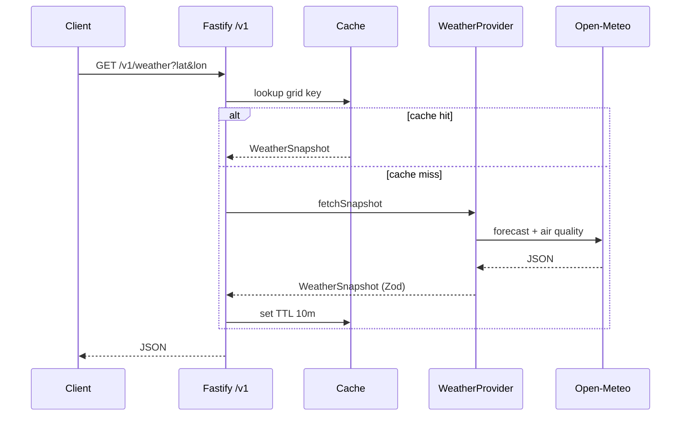

# Architecture

## Data flow (Phase 2)

## Packages

| Package | Role |
| ------- | ---- |
| `@mausam/shared` | Zod schemas, personas, India location seeds, personalisation engine (Phase 3+) |
| `@mausam/api` | HTTP edge, provider adapters, cache, geocoding |
| `@mausam/mobile` | Expo client, theme, screens |

## Personalisation (Phase 3+)

The **Personalisation Engine** will live in `@mausam/shared` as pure functions: insight modules register `{ id, personas, compute }`, scores merge persona weights and severity, and IMD warnings pin to the top of the feed.

## Documentation index

- [README](../README.md) — setup and phase roadmap
- [API.md](./API.md) — REST reference
- [DECISIONS.md](../DECISIONS.md) — product and engineering defaults
