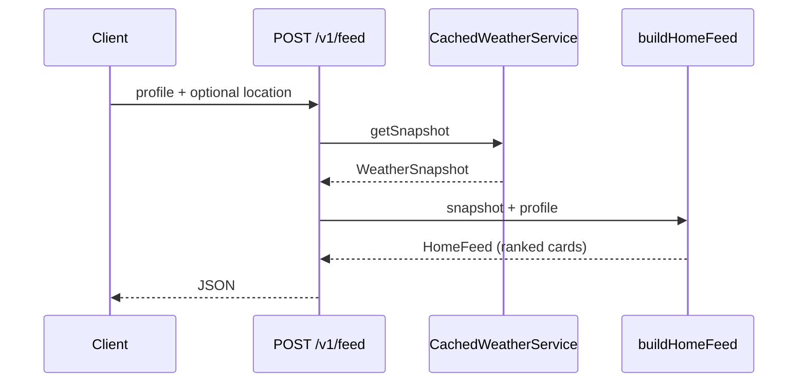
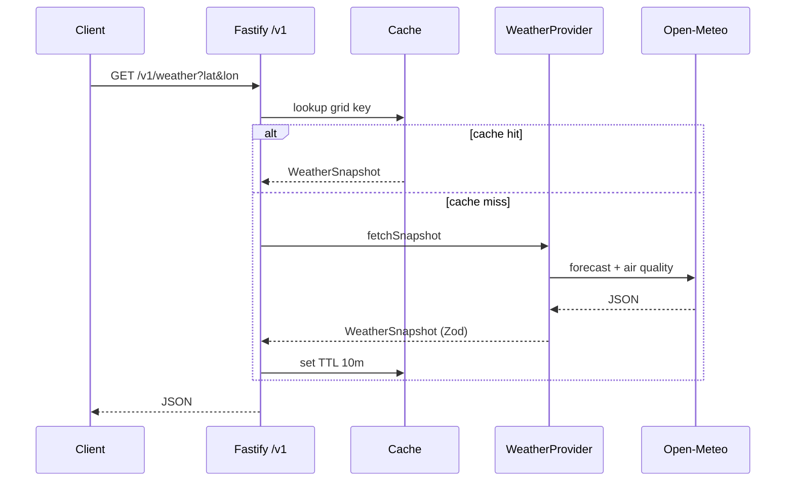

# Architecture

## Data flow (Phase 3 — feed)

## Data flow (Phase 2 — weather)

## Packages

| Package | Role |
| ------- | ---- |
| `@mausam/shared` | Zod schemas, personas, location seeds, `buildHomeFeed` engine |
| `@mausam/api` | HTTP edge, provider adapters, cache, geocoding |
| `@mausam/mobile` | Expo client, theme, screens |

## Personalisation (Phase 3)

The engine in `@mausam/shared` registers insight modules `{ id, personas, compute }`, applies persona/severity/time scoring, pins active warnings, and validates output with Zod. See [ENGINE.md](./ENGINE.md).

## Documentation index

- [README](../README.md) — setup and phase roadmap
- [API.md](./API.md) — REST reference
- [ENGINE.md](./ENGINE.md) — insight modules and extensions
- [PHASES.md](./PHASES.md) — delivery log
- [DECISIONS.md](../DECISIONS.md) — product and engineering defaults
